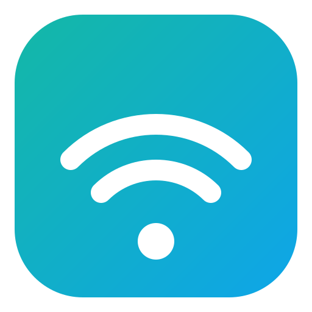
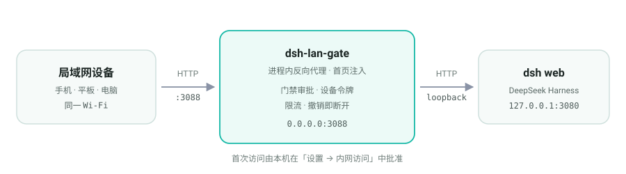

<p align="center">
  
</p>

<h1 align="center">dsh-lan-gate</h1>

<p align="center">
  让局域网内的手机、平板、电脑用浏览器访问本机 <b>DeepSeek Harness</b><br>
  首次访问需本机批准 · 设备令牌绑定 · 请求限流 · 手机排版适配 · 单文件零依赖
</p>

<p align="center">
  
  <a href="https://github.com/hchao3335-maker/dsh-public-gate"></a>
  <a href="LICENSE"></a>
  
  
  <a href="https://github.com/hchao3335-maker/dsh-lan-gate/stargazers"></a>
  <a href="https://github.com/hchao3335-maker/dsh-lan-gate/commits/main"></a>
</p>

<p align="center">
  <a href="#features"> 特性</a> ·
  <a href="#arch"> 架构</a> ·
  <a href="#install"> 安装</a> ·
  <a href="#usage"> 使用</a> ·
  <a href="#config"> 配置</a> ·
  <a href="#security"> 安全</a>
</p>

> [!WARNING]
> **本项目已停止维护。** 请改用 **[dsh-public-gate](https://github.com/hchao3335-maker/dsh-public-gate)**。
>
> - 本仓库不再更新，不接收 issue / PR，也不会有功能更新或安全修复。
> - 新项目覆盖**局域网 + 公网**两种场景：四种登录组合（密码 / TOTP / 邮箱验证码）、暴破锁定、HTTPS 反向代理、dsh 设置页内的配置面板；同样是进程内插件、零依赖。
> - **迁移**：先按新项目文档完成安装，再 `dsh plugin --profile web remove dsh-lan-gate`，删掉 `cordis.patch.yml` 里对应的行，最后重启 dsh。
> - 下文文档仅作历史参考保留，不再保证与当前 DSH 版本兼容。
>
> **Deprecated — superseded by [dsh-public-gate](https://github.com/hchao3335-maker/dsh-public-gate). No further updates or security fixes.**

一个自包含的单文件插件（`lan-gate.mjs`），进程内反向代理 + 首页注入，无外部依赖、无子进程。

<p align="center">
  
</p>

---

<a id="features"></a>
##  特性

| | 能力 | 说明 |
| :--: | --- | --- |
|  | **内网访问** | 进程内反向代理 `0.0.0.0:3088 → 127.0.0.1:3080`，局域网设备打开 `http://<电脑IP>:3088` 即可用 |
|  | **首次访问批准** | 新设备第一次访问看到「等待本机批准」，本机在 **设置 → 内网访问** 点允许后才放行 |
|  | **每台设备指定排版** | 自动 / 手机 / 电脑 三种；手机档强制紧凑排版，电脑档即使窗口很窄也保持桌面版 |
|  | **本机管理面板** | 注入 DSH 设置页：状态、启停、批准/拒绝、切换排版、撤销、复制访问地址 |
|  | **状态持久化** | 批准记录写入 `$DSH_HOME/lan-gate-state.json`，重启 DSH 后仍有效 |
|  | **安全边界** | 管理接口仅放行本机请求；转发时把 Host 重写为回环地址并通过 DSH 的信任栅栏；撤销后已建立的连接数秒内断开 |
|  | **设备令牌 + Cookie 绑定** | 每次批准签发 32 位随机令牌，设备用一次性认领链接换 `lg_token`（HttpOnly + SameSite），后续请求必须携带匹配 Cookie |
|  | **请求限流** | 每来源 IP 每分钟 120 个请求（滑动窗口），超限返回 `429` + `Retry-After` |
|  | **监听地址可配** | 默认 `0.0.0.0`；放在前置代理/隧道后面时可收紧为 `127.0.0.1` |
|  | **移动端兼容** | 门禁页手机适配、设置面板全屏化、`crypto.randomUUID` polyfill（内网 HTTP 非安全上下文） |

---

<a id="arch"></a>
##  架构

请求进来后按三种状态分流：

| 状态 | 处理 |
| --- | --- |
| **未批准** | 返回门禁页 / 拒绝页，不转发任何内容 |
| **已批准但无有效 Cookie** | 下发一次性认领链接，换取 `lg_token` Cookie |
| **已批准且 Cookie 匹配** | 转发（Host 重写 + WebSocket 升级转发） |

插件同时通过 `webServer.tapIndex` 向首页注入：`crypto.randomUUID` polyfill、设备排版 CSS，以及设置界面内的管理面板（原生 JS 实现，仅本机可见）。

---

<a id="install"></a>
##  安装（跟着做，三步完成）

### 第 1 步：把插件文件放到 DSH 数据目录

DSH 的数据目录（DSH_HOME）里存放着你的配置，插件就放这里。先确认它在哪：

**Windows（PowerShell）**，复制执行：

```powershell
echo $env:DSH_HOME
# 如果上面输出为空，则默认在：C:\Users\你的用户名\.dsh
```

**macOS / Linux（终端）**，复制执行：

```bash
echo "${DSH_HOME:-$HOME/.dsh}"
```

确认目录后，把插件放进去：

**Windows（PowerShell）**（把下面第一行换成你实际的 DSH 数据目录）：

```powershell
$dsh = "C:\Users\你的用户名\.dsh"
New-Item -ItemType Directory -Force -Path "$dsh\lan-gate" | Out-Null
Copy-Item ".\lan-gate.mjs" "$dsh\lan-gate\lan-gate.mjs" -Force
```

**macOS / Linux**：

```bash
DSH_DIR="${DSH_HOME:-$HOME/.dsh}"
mkdir -p "$DSH_DIR/lan-gate"
cp ./lan-gate.mjs "$DSH_DIR/lan-gate/lan-gate.mjs"
```

执行完，你应该能看到这个文件：`<DSH数据目录>\lan-gate\lan-gate.mjs`

### 第 2 步：注册插件（改一行配置文件）

打开文件：`<DSH数据目录>\profiles\web\cordis.patch.yml`

- 如果文件不存在，就新建一个；
- 如果文件里是 `[]`（空配置），把 `[]` 整个替换成下面内容；
- 如果文件里已经有内容，把下面这段**追加**到末尾。

```yaml
- insert:
    - id: lan-gate
      name: 'file:///C:/Users/你的用户名/.dsh/lan-gate/lan-gate.mjs'
```

**把 `name:` 里的路径换成你第 1 步实际放置的完整路径**，规则如下：

| 系统 | 写法 | 例子 |
|---|---|---|
| Windows | `file:///盘符:/完整路径` | `file:///C:/Users/你的用户名/.dsh/lan-gate/lan-gate.mjs` |
| macOS / Linux | `file:///完整路径` | `file:///home/me/.dsh/lan-gate/lan-gate.mjs` |

> **最容易踩的坑（Windows）**：必须写 `file:///D:/...`，不能写 `D:/...`。DSH 的插件加载器不会自动把 Windows 路径转成 URL，裸写会报错 `ERR_UNSUPPORTED_ESM_URL_SCHEME`。

改完保存即可，不用改任何源码。

### 第 3 步：重启 DSH 并验证

1. **完全退出**正在运行的 DSH（终端里 Ctrl+C 结束），再重新启动：

   ```bash
   pnpm dsh web        # 从源码运行时
   # 或你平时启动 DSH 的命令
   ```

2. **验证插件已加载**（二选一）：
   - 浏览器打开 `http://127.0.0.1:3080/lan-gate/status`，看到类似
     `{"state":"running","port":3088,...}` 就成功了；
   - 或者打开 DSH 网页 → 左下角齿轮进入**设置**，左侧导航出现「内网访问」。

3. 之后的日常使用见下方「使用」。

###  常见问题（按症状查）

| 现象 | 原因与解决 |
|---|---|
| 启动时报 `ERR_UNSUPPORTED_ESM_URL_SCHEME` | 第 2 步的路径没写成 `file:///` 形式，改过来再重启 |
| `/lan-gate/status` 打不开或 404 | 插件没加载成功，检查第 2 步配置，重启后看启动日志 |
| 面板显示「出错：EADDRINUSE」 | 3088 端口被占用：打开 `lan-gate.mjs`，把顶部 `PROXY_PORT = 3088` 改成其它端口（如 `3089`），重启 DSH |
| 手机打不开 `http://<电脑IP>:3088` | ① 确认手机和电脑在同一网络；② 系统防火墙放行：Windows 管理员 PowerShell 执行 `netsh advfirewall firewall add rule name="DSH LAN" dir=in action=allow protocol=TCP localport=3088` |
| 设置里看不到「内网访问」 | 面板只在本机显示，内网设备看不到是正常的；本机看不到说明插件未加载（回第 3 步验证） |
| 重启后手机又要重新批准 | 批准记录在 `<DSH数据目录>\lan-gate-state.json`，文件被删除或 DSH_HOME 变了才会丢；从旧版（临时插件）升级的用户需重新批准一次 |
| 手机显示「已绑定到其他浏览器」 | 该设备的令牌已发放给另一个浏览器（例如换浏览器、清了 Cookie、或同 IP 的别的设备抢先认领了）。在本机面板撤销该设备再重新批准，手机会自动重新认领 |
| 页面出现 429（请求过于频繁） | 该 IP 超过每分钟 120 个请求上限，等一分钟自动恢复；正常使用不会触发（网页应用远比这个频率低） |
| 用反向代理/隧道转发到本插件时全部被拒 | 前置代理过来的请求源 IP 不是本机局域网地址，需要在**前置代理**上配置登录认证后放行；然后把 `LISTEN_HOST` 改为 `127.0.0.1` 只让本机代理接入 |

---

<a id="usage"></a>
##  使用

1. 打开 DSH 设置（左下角齿轮）→ **内网访问**：面板显示运行状态与全部访问地址（点击可复制）
2. 把地址发给手机（微信/QQ 发给自己即可），手机浏览器打开
3. 手机显示「等待本机批准」，本机面板的**待批准设备**里选择 自动/手机/电脑 → 点**允许**，手机自动进入 DSH
4. 随时在面板中切换每台设备的访问方式、撤销、或停止服务

---

<a id="config"></a>
##  配置

插件顶部常量可按需修改（改完重启 DSH），也可以用环境变量覆盖（**推荐**，改文件升级时不易丢）：

| 常量 | 默认值 | 环境变量 | 说明 |
|---|---|---|---|
| `PROXY_PORT` | `3088` | `LAN_GATE_PORT` | 内网访问端口 |
| `LISTEN_HOST` | `0.0.0.0` | `LAN_GATE_HOST` | 监听地址；放在前置代理/隧道后建议改为 `127.0.0.1` |
| `RATE_LIMIT_PER_MIN` | `120` | — | 每 IP 每分钟请求上限，超限返回 429 |
| `TARGET_HOST` | `127.0.0.1` | — | DSH 服务地址 |
| `TARGET_PORT` | `3080` | — | DSH 服务端口 |

---

<a id="uninstall"></a>
##  卸载

删除 `cordis.patch.yml` 中的 lan-gate 行（或整段 `- insert:`），重启 DSH。批准记录如需清除，删除 `$DSH_HOME/lan-gate-state.json`。

---

<a id="security"></a>
##  安全提示

- 本插件是**内网转发**：传输没有加密，请只在可信的局域网内使用，**不要把 `3088` 端口直接暴露到公网**（端口映射到公网 = 裸奔）
- **要上外网（WAN）必须先加 HTTPS + 登录认证**，推荐方案（二选一）：
  - **Cloudflare Tunnel + Cloudflare Access**（免费，不需要公网 IP）：Access 的登录与 MFA 挡在所有流量前面，再到本插件
  - **Caddy（自动 HTTPS）+ Authelia / basic_auth**：有公网 IP/域名时的自托管方案
  - 用了前置代理后，把 `LISTEN_HOST` 改成 `127.0.0.1`（或设 `LAN_GATE_HOST=127.0.0.1`），只让本机代理接入
  - 更省事的做法：直接用继任项目 [dsh-public-gate](https://github.com/hchao3335-maker/dsh-public-gate)，自带 HTTPS 与登录认证
- 本插件的自带防线（v1.1）：每 IP 限流、设备令牌 + Cookie 绑定、管理接口仅本机、撤销即断开
- **已知限制（请了解）**：令牌绑定按 IP + Cookie 实现，同一个 IP 后面的多个设备（例如同一 NAT / 同一路由后的多台手机）共享一次批准；极端情况下同 IP 的攻击者理论上可在认领瞬间抢先换取 Cookie。真正的多设备/多用户隔离，请用上面推荐的「前置代理 + 登录认证」方案
- 撤销 = 立即断开对应设备（含已建立的连接），且撤销后重新批准会签发全新令牌，旧 Cookie 立即失效

---

<a id="compat"></a>
##  兼容性

- DeepSeek Harness（run-from-source 的 web profile）
- Node ≥ 18（仅使用内置模块）
- 现代浏览器（Chrome / Safari / Firefox / 微信内置浏览器）

---

<a id="contact"></a>
##  联系

本项目已归档，不再接收问题反馈。新项目相关问题请到
[dsh-public-gate issues](https://github.com/hchao3335-maker/dsh-public-gate/issues) 提交。

---

##  许可证

[MIT](LICENSE) © 2026 [xianyiliang](https://github.com/hchao3335-maker)

<p align="center"><sub>项目已归档；新需求请到 <a href="https://github.com/hchao3335-maker/dsh-public-gate">dsh-public-gate</a>。</sub></p>
